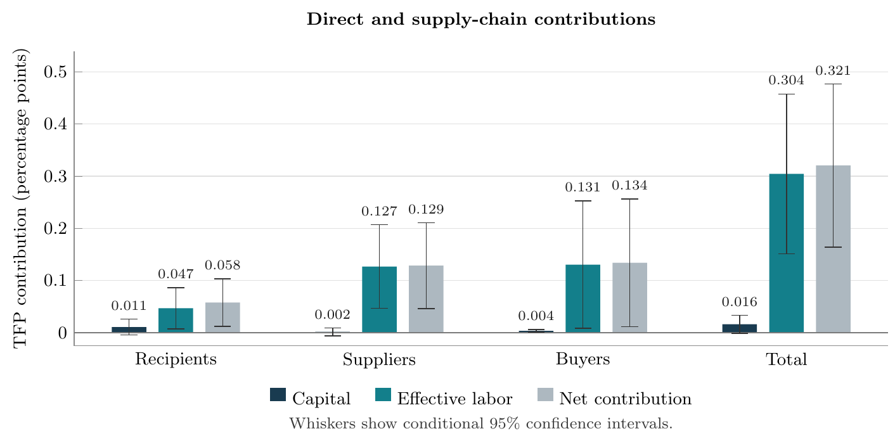

:::{#short-bio}

I am a Ph.D. candidate in economics at **UCLA**.

**Research Fields: Trade, International Macro, and Development.**

**I am on the 2026–2027 economics job market.**

:::

## Job Market Paper

### [Government Venture Capital, Production Networks, and Aggregate Productivity in China](https://www.dropbox.com/scl/fi/r535y97sbinfpkbymdgqv/Sunny_Liang_Tan_JMP.pdf?rlkey=c87sw1oevh17pybb09yctpkxu&st=mn068qw6&dl=0)

:::: {.jmp-panel}

<figure class="jmp-takeaway">
  
  <figcaption><strong>Key takeaway.</strong> In the current draft’s benchmark, suppliers and buyers account for about 82% of the manufacturing TFP gain. <a class="jmp-figure-link" href="research/figures/section7_factor_decomposition_95ci_labeled.pdf">Full-size figure (PDF)</a></figcaption>
</figure>

::: {.jmp-abstract}
Industrial policy can reshape production well beyond the firms it directly supports, and assessing its aggregate productivity implications therefore requires measuring how supply-chain spillovers amplify or counteract recipient gains. This paper provides the first joint analysis of these direct, upstream, and downstream contributions in the setting of government venture capital in China.

Linking investment records to firm accounts, patents, and supplier–buyer transactions, we identify expansion among financed firms and their existing trading partners. Both suppliers and buyers increase sales and payroll, and buyers also increase gross fixed assets. We combine these responses with baseline allocation statistics in a production-network framework that values both the resources absorbed by expanding firms and those released elsewhere. In a broad-population calibration with fixed industry factor supplies, suppliers and buyers make similar contributions and together account for most of the productivity gain. Reallocation of effective labor accounts for most of the gain. The analysis shows that production networks can substantially enlarge the productivity contribution suggested by recipient outcomes alone, highlighting their importance for evaluating industrial policy.
:::

::::
