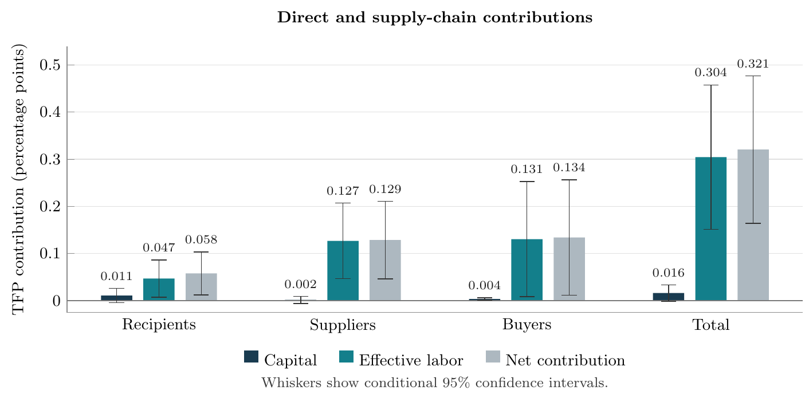

## Job Market Paper

::: {.research-paper #industrial-policy}

### [Government Venture Capital, Production Networks, and Aggregate Productivity in China](https://www.dropbox.com/scl/fi/r535y97sbinfpkbymdgqv/Sunny_Liang_Tan_JMP.pdf?rlkey=c87sw1oevh17pybb09yctpkxu&st=mn068qw6&dl=0) {.paper-title .unnumbered .unlisted}

:::: {.jmp-panel}

<figure class="jmp-takeaway">
  
  <figcaption><strong>Key takeaway.</strong> In the current draft’s benchmark, suppliers and buyers account for about 82% of the manufacturing TFP gain. <a class="jmp-figure-link" href="figures/section7_factor_decomposition_95ci_labeled.pdf">Full-size figure (PDF)</a></figcaption>
</figure>

::: {.jmp-abstract}
Industrial policy can reshape production well beyond the firms it directly supports, and assessing its aggregate productivity implications therefore requires measuring how supply-chain spillovers amplify or counteract recipient gains. This paper provides the first joint analysis of these direct, upstream, and downstream contributions in the setting of government venture capital in China.

Linking investment records to firm accounts, patents, and supplier–buyer transactions, we identify expansion among financed firms and their existing trading partners. Both suppliers and buyers increase sales and payroll, and buyers also increase gross fixed assets. We combine these responses with baseline allocation statistics in a production-network framework that values both the resources absorbed by expanding firms and those released elsewhere. In a broad-population calibration with fixed industry factor supplies, suppliers and buyers make similar contributions and together account for most of the productivity gain. Reallocation of effective labor accounts for most of the gain. The analysis shows that production networks can substantially enlarge the productivity contribution suggested by recipient outcomes alone, highlighting their importance for evaluating industrial policy.
:::

::::

:::

## Working Papers

::: {.research-paper #exchange-rate}

### [Exchange-Rate Movements and U.S. Corporations](exchange-rate-paper.pdf) {.paper-title .unnumbered .unlisted}

::: {.paper-authors}
Joint with [Ivo Welch](https://www.ivo-welch.org/home/) and [Yuqing Zhou](https://www.yuqingzhou.com).
:::

This paper revisits the exchange-rate exposure puzzle: why prior research finds weak relationships between currency movements and U.S. firms’ stock returns despite substantial international trade. Linking transaction-level U.S. Census export records to financial statements and stock returns for publicly traded U.S. exporters from 1992 to 2016, we construct firm-specific exchange-rate exposure measures that reflect each firm’s export destinations. Dollar depreciation is associated with economically significant increases in exports, sales, profitability, and stock returns, with export, sales, and stock-return sensitivities generally larger among larger and more export-oriented firms. In asset- or export-weighted specifications, a 1% depreciation is associated with approximately 0.4-0.6% higher exports and 0.6-0.8% higher sales. The stronger sales response is consistent with currency movements affecting domestic competitiveness as well as foreign demand, while the profitability results indicate that financial and operational hedging do not fully offset exposure. Real operating sensitivities increase over time. Stock prices respond contemporaneously, with no detectable delayed response around subsequent earnings announcements. By measuring exposure using firms’ actual trading relationships and tracing its implications across operating outcomes and equity valuations, the paper contributes new evidence to the exchange-rate exposure literature and shows that substantial corporate currency exposure can coexist with timely incorporation of information into stock prices.

:::

## Work in Progress {.no-anchor}

::: {.research-paper #ev-battery}

### Upstream Scale Economies and Investment Complementarities {.paper-title .unnumbered .unlisted .no-anchor}

::: {.paper-authors}
Joint with Binkai Chen and Junjie Xia.
:::

:::

::: {.research-paper #semiconductor}

### Chipmakers’ Process Node Upgrades and Upstream Supplier Learning {.paper-title .unnumbered .unlisted .no-anchor}

::: {.paper-authors}
Joint with Mervyn Ho.
:::

:::

::: {.research-paper #mexico-nearshoring}

### Worker Mobility and Returns to Multinational Experience in Mexico {.paper-title .unnumbered .unlisted .no-anchor}

::: {.paper-authors}
With Martin Tobal.
:::

:::

::: {.research-paper #multinational-production}

### Tariffs and Cross-Border Vertical Integration in Third Countries {.paper-title .unnumbered .unlisted .no-anchor}

:::
